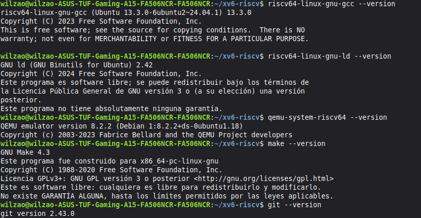
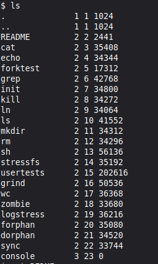
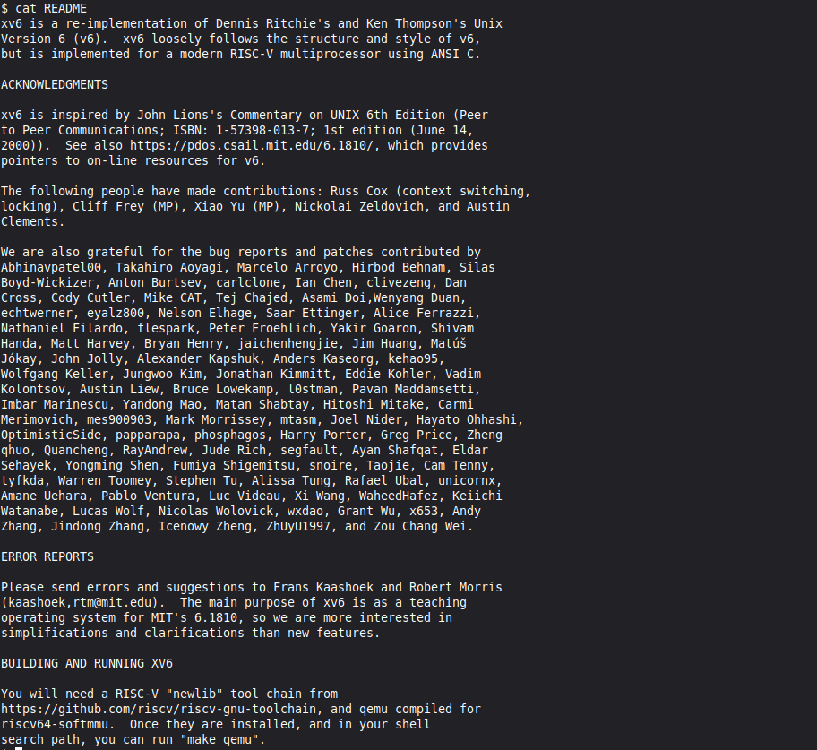
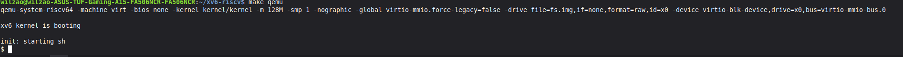
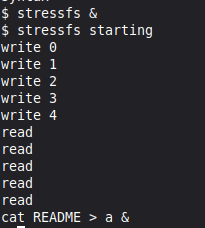

# Exploración de la planificación de procesos en XV6

*Análisis del planificador original y propuesta teórica para incorporar MLFQ*

**Curso:** Sistemas Operativos — Universidad del Valle  
**Modalidad:** trabajo en parejas  
**Integrantes:**
- Wilson Pinto Cordoba — 2521251
- Luvian Steven Parra Rendon — 2518972

**Repositorio (fork):** https://github.com/wizao-creator/xv6-riscv  
**Servicio de IA y modelo utilizado:** Gemini IA 4 Hydrogen  
**Fecha:** 17 de noviembre de 2026

---

## 1. Preparación del repositorio y del entorno

Para el desarrollo de la práctica se realizó un fork del repositorio oficial `mit-pdos/xv6-riscv` hacia la cuenta personal de GitHub y posteriormente se clonó de forma local en el entorno de trabajo Linux para compilar y ejecutar el sistema operativo sobre arquitectura RISC-V.

A continuación se detallan las especificaciones del entorno anfitrión, las herramientas utilizadas y el punto exacto del historial de versiones desde el cual parten las modificaciones:

- **Repositorio de trabajo (fork):** https://github.com/wizao-creator/xv6-riscv
- **Commit base (SHA-1):** `fa2ddcb7ca87a77af579380a6eafd5aff163b44f`
  - **Autor y fecha:** koki kitamura — 30 de octubre de 2026 (`Fri Oct 30 17:37:13 2026 +0900`)
  - **Mensaje del commit:** *usertests: bound the zero-length pipe read regression test*
- **Sistema operativo anfitrión:** Linux Mint 22.3 (*Zena*, derivado de Ubuntu *Noble*)
- **Versión del kernel Linux:** `Linux 6.14.0-37-generic`
- **Herramientas de compilación y emulación:** compilador cruzado `riscv64-linux-gnu-gcc` y emulador `qemu-system-riscv64` (verificados mediante `riscv64-linux-gnu-gcc --version` y `qemu-system-riscv64 --version`).

### 1.1. Versiones de las herramientas

Versiones de las herramientas usadas para compilar y ejecutar XV6:

| Herramienta | Comando de verificación | Versión obtenida |
| --- | --- | --- |
| Compilador cruzado RISC-V | `riscv64-linux-gnu-gcc --version` | riscv64-linux-gnu-gcc (Ubuntu 13.3.0-6ubuntu2~24.04.1) 13.3.0 |
| Enlazador / binutils RISC-V | `riscv64-linux-gnu-ld --version` | GNU ld (GNU Binutils for Ubuntu) 2.42 |
| Emulador QEMU | `qemu-system-riscv64 --version` | QEMU emulator version 8.2.2 (Debian 1:8.2.2+ds-0ubuntu1.18) |
| GNU Make | `make --version` | GNU Make 4.3 (construido para x86_64-pc-linux-gnu) |
| Git | `git --version` | git version 2.43.0 |



### 1.2. Instrucciones reproducibles

Pasos seguidos (en Debian/Ubuntu/Linux Mint) para reproducir el entorno.

```bash
# 1. Instalar dependencias
sudo apt-get install git build-essential gdb-multiarch qemu-system-misc \
     gcc-riscv64-linux-gnu binutils-riscv64-linux-gnu

# 2. Clonar el fork y fijar el commit de partida
git clone https://github.com/wizao-creator/xv6-riscv
cd xv6-riscv
git checkout fa2ddcb7ca87a77af579380a6eafd5aff163b44f   # (o permanecer en la rama de trabajo)

# 3. Compilar y ejecutar con una sola CPU virtual
make CPUS=1 qemu          # equivale a dejar CPUS := 1 en el Makefile

# 4. Salir de QEMU: Ctrl-a seguido de x
```

---

## 2. Compilación y ejecución de XV6

### 2.1. Verificación de operatividad del sistema

Tras clonar el repositorio, se compiló el código fuente del núcleo y de las utilidades de usuario mediante el comando `make qemu`, generando la imagen del kernel (`kernel/kernel`) y del sistema de archivos (`fs.img`). Una vez completado el arranque e iniciado el intérprete de comandos (`sh`), se ejecutaron las utilidades `ls` y `cat` para comprobar la correcta operación del sistema de archivos y la ejecución de procesos en espacio de usuario.



**Figura 1.** *Ejecución del comando `ls` en la consola de xv6-riscv. La salida muestra el listado de archivos y binarios disponibles en el directorio raíz del sistema de archivos virtual (`fs.img`), junto con su tipo, número de inodo y tamaño en bytes, verificando el montaje correcto del sistema de archivos y la ejecución de procesos de usuario.*



**Figura 2.** *Ejecución del comando `cat README` en xv6-riscv. El proceso lee el archivo de documentación desde el sistema de archivos y despliega su contenido íntegro por la salida estándar, comprobando el funcionamiento adecuado de las llamadas al sistema de lectura/escritura (`open`, `read`, `write` y `close`) sobre el emulador QEMU.*

### 2.2. Configuración de una única CPU virtual en QEMU

Por defecto, el archivo `Makefile` de `xv6-riscv` define la variable `CPUS := 3`, la cual se transfiere a la línea de comandos del emulador mediante la bandera `-smp $(CPUS)` dentro de la regla `QEMUOPTS`. Para restringir la ejecución a un único procesador virtual sin alterar la configuración de hardware del equipo anfitrión, se modificó dicho parámetro en el `Makefile` a **`CPUS := 1`** (equivalente a invocar `make CPUS=1 qemu`).



**Figura 3.** *Arranque de xv6-riscv configurado con una única CPU virtual. En el comando de invocación de QEMU se observa el parámetro `-smp 1` y, durante la secuencia de inicialización del kernel (`xv6 kernel is booting`), únicamente se activa el núcleo principal (`hart 0`), omitiéndose los mensajes de arranque de núcleos secundarios (`hart 1 starting` y `hart 2 starting`) antes de iniciar el proceso `sh`.*

---

## 3. Investigación del planificador original de XV6

### 3.1. Algoritmo de planificación por defecto y evidencia en su comportamiento

Por defecto, `xv6-riscv` utiliza un planificador **Round-Robin (RR) apropiativo** sin prioridades, implementado mediante un recorrido circular secuencial sobre un arreglo estático de procesos (`proc[NPROC]`, con capacidad máxima `NPROC = 64` definida en `kernel/param.h`). Todos los procesos listos para ejecutarse reciben exactamente el mismo *quantum* de tiempo, delimitado por las interrupciones periódicas del temporizador (*timer interrupts*) del hardware RISC-V.

Este comportamiento se evidencia en la operación del sistema sobre una única CPU virtual (`CPUS=1`) de las siguientes maneras:

- **Alternancia equitativa de procesos intensivos en CPU:** al lanzar en segundo plano (`&`, uno por línea en el shell de xv6) múltiples procesos concurrentes que demandan procesamiento o escritura continua (por ejemplo, `stressfs &` junto con comandos de usuario en background), ninguno bloquea por completo al resto hasta terminar. La única CPU disponible va alternando entre los procesos activos cada vez que ocurre una interrupción del temporizador y el proceso actual cede el procesador.
- **Ausencia de prioridades y orden estático:** sin importar si un proceso es corto o de larga duración, el planificador siempre recorre la tabla `proc[]` desde la posición `0` hasta `NPROC - 1` asignando turnos equivalentes a cada proceso en estado `RUNNABLE`, sin penalizar ni favorecer a ningún proceso según su historial de uso de CPU.



**Figura 4.** *Evidencia del comportamiento Round-Robin sobre una única CPU virtual (`-smp 1`). Al ejecutar procesos concurrentes en segundo plano, sus salidas se intercalan en la terminal conforme ocurren las interrupciones del temporizador y los cambios de contexto, demostrando el reparto equitativo del procesador sin inanición ni prioridades.*

### 3.2. Archivo y función donde se selecciona el siguiente proceso para la CPU

La selección del siguiente proceso que entra a la CPU se implementa en el archivo **`kernel/proc.c`**, dentro de la función **`void scheduler(void)`**. Cada CPU virtual (*hart*) ejecuta su propia instancia de esta función en un bucle infinito (`for(;;)`), recorriendo secuencialmente el arreglo global `struct proc proc[NPROC]` en busca del primer proceso cuyo estado sea `RUNNABLE`.

- **Ruta del archivo:** `kernel/proc.c` (apoyado por la definición de `struct proc` en `kernel/proc.h`).
- **Función:** `void scheduler(void)`
- **Fragmento de código (`kernel/proc.c`):**

```c
// Per-CPU process scheduler.
// Each CPU calls scheduler() after setting itself up.
// Scheduler never returns.  It loops, doing:
//  - choose a process to run.
//  - swtch to start running that process.
//  - eventually that process transfers control
//    via swtch back to the scheduler.
void
scheduler(void)
{
  struct proc *p;
  struct cpu *c = mycpu();

  c->proc = 0;
  for(;;){
    // The most recent process to run may have had interrupts
    // turned off; enable them to avoid a deadlock if all
    // processes are waiting. Then turn them back off
    // to avoid a possible race between an interrupt
    // and wfi.
    intr_on();
    intr_off();

    int found = 0;
    for(p = proc; p < &proc[NPROC]; p++) {
      acquire(&p->lock);
      if(p->state == RUNNABLE) {
        // Switch to chosen process.  It is the process's job
        // to release its lock and then reacquire it
        // before jumping back to us.
        p->state = RUNNING;
        c->proc = p;
        swtch(&c->context, &p->context);

        // Process is done running for now.
        // It should have changed its p->state before coming back.
        c->proc = 0;
        found = 1;
      }
      release(&p->lock);
    }
    if(found == 0) {
      // nothing to run; stop running on this core until an interrupt.
      asm volatile("wfi");
    }
  }
}
```

### 3.3. Relación con los estados de los procesos y eventos de cesión/recuperación de la CPU

En **`kernel/proc.h`**, cada proceso tiene asociado un estado definido en la enumeración `enum procstate`:

```c
enum procstate { UNUSED, USED, SLEEPING, RUNNABLE, RUNNING, ZOMBIE };
```

La transición entre el proceso que ocupa la CPU, el que la cede y el siguiente en entrar ocurre mediante el siguiente ciclo de estados y eventos:

**1. Entrada a la CPU (`RUNNABLE` → `RUNNING`):**

- En `scheduler()` (`kernel/proc.c`), solo son elegibles los procesos cuyo estado es **`RUNNABLE`**.
- Al encontrar uno, el planificador adquiere su cerrojo (`acquire(&p->lock)`), actualiza su estado a **`RUNNING`**, lo asigna como proceso activo de la CPU (`c->proc = p`) y ejecuta **`swtch(&c->context, &p->context)`** (rutina en ensamblador definida en **`kernel/swtch.S`**), guardando los registros del planificador y restaurando los del proceso seleccionado.

**2. Cesión de la CPU y salida del proceso activo (`RUNNING` → `RUNNABLE` / `SLEEPING` / `ZOMBIE`):**

- Todo proceso que abandona la CPU debe cambiar previamente su estado fuera de `RUNNING` y llamar a **`sched()`** (`kernel/proc.c`), la cual ejecuta `swtch(&p->context, &mycpu()->context)` para devolver el control al bucle de `scheduler()`, donde se limpia `c->proc = 0` y se libera `p->lock`.
- **Fragmento de `sched()` (`kernel/proc.c`):**

```c
void
sched(void)
{
  int intena;
  struct proc *p = myproc();

  if(!holding(&p->lock))
    panic("sched p->lock");
  if(mycpu()->noff != 1)
    panic("sched locks");
  if(p->state == RUNNING)
    panic("sched running");
  if(intr_get())
    panic("sched interruptible");

  intena = mycpu()->intena;
  swtch(&p->context, &mycpu()->context);
  mycpu()->intena = intena;
}
```

- **Eventos principales que provocan la cesión de la CPU:**
  - **Interrupción del temporizador (*preemption* / fin de quantum):** en **`kernel/trap.c`**, dentro de `usertrap()` y `kerneltrap()`, cuando `devintr()` retorna `2` (interrupción de reloj), se invoca **`yield()`** (`kernel/proc.c`), pasando el proceso de `RUNNING` a **`RUNNABLE`**:

```c
// En kernel/trap.c (dentro de usertrap y kerneltrap)
if(which_dev == 2)
  yield();

// En kernel/proc.c
void
yield(void)
{
  struct proc *p = myproc();
  acquire(&p->lock);
  p->state = RUNNABLE;
  sched();
  release(&p->lock);
}
```

  - **Bloqueo voluntario por E/S o sincronización (`sleep`):** cuando un proceso espera una operación de disco, consola o canal de sincronización, llama a **`sleep(void *chan, struct spinlock *lk)`** (`kernel/proc.c`), pasando de `RUNNING` a **`SLEEPING`** antes de invocar `sched()`.
  - **Terminación del proceso (`exit`):** al finalizar su ejecución, el proceso llama a **`kexit()`** (`kernel/proc.c`), cambiando su estado de `RUNNING` a **`ZOMBIE`** y llamando a `sched()` por última vez.

**3. Recuperación de la CPU (transición a `RUNNABLE`):**

- Cuando un proceso nuevo es creado mediante **`userinit()`** o **`kfork()`** (`kernel/proc.c`), o cuando un evento externo o de E/S despierta a un proceso dormido mediante **`wakeup(void *chan)`** (`kernel/proc.c`), su estado pasa de `USED` o `SLEEPING` a **`RUNNABLE`**, haciéndolo nuevamente elegible en `scheduler()`:

```c
// En kernel/proc.c
void
wakeup(void *chan)
{
  struct proc *p;

  for(p = proc; p < &proc[NPROC]; p++) {
    if(p != myproc()){
      acquire(&p->lock);
      if(p->state == SLEEPING && p->chan == chan) {
        p->state = RUNNABLE;
      }
      release(&p->lock);
    }
  }
}
```

### 3.4. Incorporación del planificador en la compilación y construcción de XV6

La integración del código del planificador en el binario final del sistema operativo ocurre en tres etapas definidas en el **`Makefile`**, el script del enlazador **`kernel/kernel.ld`** y la secuencia de arranque en **`kernel/main.c`**:

**1. Compilación a código objeto (`Makefile`):**

- En el `Makefile` raíz, el archivo fuente `kernel/proc.c` forma parte de la lista de objetos del núcleo (`OBJS`) bajo la entrada **`$K/proc.o`** (junto con `$K/swtch.o`, `$K/trap.o` y `$K/main.o`). El compilador cruzado `riscv64-linux-gnu-gcc` compila cada archivo `.c` en modo *freestanding* generando su respectivo archivo objeto `.o`.
- **Fragmento del `Makefile`:**

```makefile
K=kernel
OBJS = \
  $K/entry.o \
  $K/start.o \
  ...
  $K/proc.o \
  $K/swtch.o \
  $K/trampoline.o \
  $K/trap.o \
  ...
```

**2. Enlazado (*linking*) en la imagen del kernel (`Makefile` y `kernel/kernel.ld`):**

- La regla `$K/kernel` del `Makefile` invoca al enlazador `riscv64-linux-gnu-ld` con el script **`kernel/kernel.ld`**, uniendo `$K/proc.o` con el resto de módulos del kernel para producir el ejecutable **`kernel/kernel`**.
- **Fragmento del `Makefile`:**

```makefile
$K/kernel: $(OBJS) $K/kernel.ld
    $(LD) $(LDFLAGS) -T $K/kernel.ld -o $K/kernel $(OBJS)
    $(OBJDUMP) -S $K/kernel > $K/kernel.asm
    $(OBJDUMP) -t $K/kernel | sed '1,/SYMBOL TABLE/d; s/ .* / /; /^$$/d' > $K/kernel.sym
```

- En **`kernel/kernel.ld`**, se define el punto de entrada `_entry` y la dirección base `0x80000000`, ubicando las secciones `.text` de todos los objetos (`*(.text .text.*)`) —incluidas las instrucciones compiladas de `scheduler()`— en la memoria donde QEMU carga el kernel.

**3. Ejecución durante el arranque del sistema (`kernel/entry.S` → `kernel/start.c` → `kernel/main.c`):**

- Al iniciar QEMU (`qemu-system-riscv64 ... -kernel kernel/kernel`), la CPU arranca en `_entry` (`kernel/entry.S`), pasa por `start()` (`kernel/start.c`) para configurar las interrupciones de temporizador y entra en modo supervisor a **`main()`** (`kernel/main.c`). Tras inicializar la tabla de procesos (`procinit()`) y crear el primer proceso de usuario (`userinit()`), `main()` llama directamente a **`scheduler()`**, cediendo el control permanente de la CPU al bucle del planificador:

```c
// En kernel/main.c (final de la función main)
void
main()
{
  if(cpuid() == 0){
    ...
    procinit();      // process table
    ...
    userinit();      // first user process
    __atomic_store_n(&started, 1, __ATOMIC_RELEASE);
  } else {
    ...
  }

  scheduler();
}
```

---

## 4. Descripción de MLFQ y exploración de su incorporación a XV6

*Alcance:* esta sección es solo teórica. No se implementa MLFQ ni se programan ni ejecutan los escenarios de prueba; todo lo que se propone son cambios y comprobaciones a futuro.

### 4.1. Descripción inicial de MLFQ (escrita antes de consultar a la IA)

Descripción inicial escrita por la pareja a partir de lo estudiado (video del curso y capítulo de OSTEP), incluida en el prompt 1:

> Para mi trabajo de Sistemas Operativos, estoy trabajando con el planificador Multi-Level Feedback Queue (MLFQ), un algoritmo diseñado para minimizar tanto el tiempo de retorno (*turnaround time*) como el tiempo de respuesta en tareas interactivas, sin necesidad de conocer de antemano la duración de cada proceso. En lugar de usar prioridades fijas, el MLFQ organiza los trabajos en varias colas con distintos niveles de prioridad y ajusta dinámicamente la prioridad de cada proceso aprendiendo de su comportamiento histórico durante la ejecución.
>
> El funcionamiento base del algoritmo que voy a utilizar se rige por cinco reglas fundamentales:
>
> - *Selección y Round-Robin:* si un proceso A tiene mayor prioridad que B, se ejecuta A; si ambos están en la misma cola, se alternan mediante Round-Robin usando el quantum correspondiente a ese nivel.
> - *Entrada al sistema:* todo proceso nuevo ingresa directamente en la cola de máxima prioridad, asumiendo inicialmente que podría tratarse de un trabajo corto.
> - *Degradación y control de abuso (accounting):* cuando un proceso agota su asignación de tiempo (allotment) en un nivel —sin importar cuántas veces haya cedido la CPU por operaciones de E/S—, baja un nivel de prioridad. Esto mantiene a las tareas interactivas en las colas altas y evita que un proceso manipule el planificador liberando la CPU justo antes de acabar su turno para monopolizar recursos.
> - *Aumento periódico de prioridad (priority boost):* cada cierto periodo de tiempo S, todos los procesos del sistema suben a la cola de mayor prioridad para evitar la inanición (*starvation*) de los trabajos largos intensivos en CPU y permitir que procesos que cambien de fase vuelvan a ser tratados como interactivos.
>
> Adicionalmente, las colas superiores suelen configurarse con quantums cortos para dar respuesta rápida a procesos interactivos, mientras que las inferiores emplean quantums más largos para ejecutar eficientemente tareas pesadas de CPU. Este modelo sirve de base para planificadores reales como los de Solaris, FreeBSD y Windows.

### 4.2. Prompt 1 enviado a la IA

Se utilizó una conversación nueva. El prompt incluye la descripción inicial de MLFQ y una síntesis del trabajo de las secciones 1 a 3.

```text
Actúa como tutor socrático de una pareja de estudiantes de cuarto semestre de Ingeniería de Sistemas. Conocemos C++ y hemos comenzado a explorar XV6 para RISC-V.

Queremos identificar y justificar qué se necesitaría para incorporar MLFQ a XV6. En esta entrega no vamos a implementarlo.

Nuestra descripción inicial del algoritmo, escrita antes de esta conversación:
Nuestra descripción inicial del algoritmo, escrita antes de esta conversación:
Para mi trabajo de Sistemas Operativos, estoy trabajando con el planificador Multi-Level Feedback Queue (MLFQ), un algoritmo diseñado para minimizar tanto el tiempo de retorno (turnaround time) como el tiempo de respuesta en tareas interactivas, sin necesidad de conocer de antemano la duración de cada proceso. En lugar de usar prioridades fijas, el MLFQ organiza los trabajos en varias colas con distintos niveles de prioridad y ajusta dinámicamente la prioridad de cada proceso aprendiendo de su comportamiento histórico durante la ejecución.
El funcionamiento base del algoritmo que voy a utilizar se rige por cinco reglas fundamentales:
1. Selección y Round-Robin: Si un proceso A tiene mayor prioridad que B, se ejecuta A; si ambos están en la misma cola, se alternan mediante Round-Robin usando el quantum correspondiente a ese nivel.
2. Entrada al sistema: Todo proceso nuevo ingresa directamente en la cola de máxima prioridad, asumiendo inicialmente que podría tratarse de un trabajo corto.
3.Degradación y control de abuso (accounting): Cuando un proceso agota su asignación de tiempo (allotment) en un nivel —sin importar cuántas veces haya cedido la CPU por operaciones de E/S—, baja un nivel de prioridad. Esto mantiene a las tareas interactivas en las colas altas y evita que un proceso manipule el planificador liberando la CPU justo antes de acabar su turno para monopolizar recursos.
4.Aumento periódico de prioridad (Priority Boost): Cada cierto periodo de tiempo S, todos los procesos del sistema suben a la cola de mayor prioridad para evitar la inanición (starvation) de los trabajos largos intensivos en CPU y permitir que procesos que cambien de fase vuelvan a ser tratados como interactivos.

Adicionalmente, las colas superiores suelen configurarse con quantums cortos para dar respuesta rápida a procesos interactivos, mientras que las inferiores emplean quantums más largos para ejecutar eficientemente tareas pesadas de CPU. Este modelo sirve de base para planificadores reales como los de Solaris, FreeBSD y Windows.

Lo que averiguamos del planificador original y de su incorporación al sistema compilado:
BREVE SÍNTESIS
================================================================================

Contexto del proyecto de Sistemas Operativos (implementación de MLFQ en xv6-riscv):

1. Entorno y configuración base:
   - Fork de mit-pdos/xv6-riscv en https://github.com/wizao-creator/xv6-riscv partiendo del commit fa2ddcb7ca87a77af579380a6eafd5aff163b44f.
   - Compilado y ejecutado en Linux Mint 22.3 (Kernel Linux 6.14.0-37-generic) usando riscv64-linux-gnu-gcc y qemu-system-riscv64.
   - Configurado a una sola CPU virtual (CPUS := 1 en Makefile, bandera -smp 1 en QEMU) para observar el planificador en un único hart.

2. Hallazgos del planificador original de xv6:
   - Política por defecto: Round-Robin apropiativo sin prioridades sobre el arreglo estático proc[NPROC] (NPROC = 64 en kernel/param.h).
   - Selección de procesos: Implementada en void scheduler(void) dentro de kernel/proc.c, que recorre proc[] buscando procesos en estado RUNNABLE, cambia su estado a RUNNING y realiza el cambio de contexto mediante swtch(&c->context, &p->context) (kernel/swtch.S).
   - Ciclo de estados (enum procstate en kernel/proc.h):
     * RUNNABLE -> RUNNING: En scheduler() (kernel/proc.c).
     * RUNNING -> RUNNABLE: Por interrupción del temporizador (which_dev == 2) en usertrap() y kerneltrap() (kernel/trap.c), que llaman a yield() -> sched() (kernel/proc.c).
     * RUNNING -> SLEEPING / ZOMBIE: Mediante sleep() y kexit() (kernel/proc.c), llamando a sched().
     * SLEEPING / USED -> RUNNABLE: Mediante wakeup(), userinit() y kfork() (kernel/proc.c).
   - Compilación y arranque: El Makefile compila kernel/proc.c a kernel/proc.o dentro de OBJS, el enlazador ld lo integra en kernel/kernel usando kernel/kernel.ld (dirección base 0x80000000), y al final del arranque en main() (kernel/main.c) se invoca scheduler().

Reglas de interacción:

1. Formula una sola pregunta principal por turno y espera nuestra respuesta. No presentes una lista completa de cambios ni una arquitectura resuelta.
2. Empieza examinando nuestra descripción de MLFQ. Ayúdanos a detectar reglas ambiguas, ausentes o contradictorias. No sustituyas nuestra descripción por una versión terminada ni elijas silenciosamente una variante del algoritmo.
3. Pídenos que propongamos y justifiquemos las decisiones que faltan. Después, ayúdanos a comprobarlas con ejemplos pequeños de procesos y decisiones de planificación que nosotros debamos resolver.
4. Guíanos para relacionar cada regla con XV6. Antes de sugerir una modificación, pregúntanos qué comportamiento necesitamos y qué evidencia del código respalda nuestra propuesta.
5. No supongas que tienes acceso a nuestro repositorio. Pide los fragmentos necesarios y distingue lo observado de lo que todavía sea una hipótesis. No inventes archivos, funciones o comportamientos de nuestra versión.
6. No entregues código de implementación, parches, una lista cerrada de archivos por modificar ni pseudocódigo que resuelva el planificador. Revisa nuestras propuestas y señala problemas mediante preguntas y pistas graduales. Puedes explicar conceptos previos con ejemplos mínimos.
7. Si nos bloqueamos, reduce la dificultad de la pregunta y ofrece una pista concreta. Si pedimos la solución directa, conserva el modo socrático.

El objetivo es que nosotros logremos:

A. Redactar una descripción revisada y coherente de la variante de MLFQ considerada.
B. Explicar qué cambios necesitaría XV6 para soportarla, indicando para cada uno su propósito, su relación con las reglas y la evidencia del código que lo justifica.
C. Proponer escenarios para comprobar una futura implementación del algoritmo MLFQ en el sistema operativo XV6. Pídenos que expliquemos qué procesos participarían, qué harían, qué regla comprobaríamos y qué comportamiento esperaríamos observar. No nos entregues los escenarios resueltos. En esta tarea solo los describiremos; no vamos a programarlos ni ejecutarlos.

Mantén el análisis dentro del alcance de una propuesta: no necesitamos implementar MLFQ ni construir un selector de planificadores. Ayúdanos a registrar las cuestiones que queden pendientes de investigación.

Al finalizar, pídenos que redactemos nuestras conclusiones. Comprueba su consistencia mediante una última pregunta aplicada a un caso concreto, sin escribir por nosotros el reporte.

Comienza con una pregunta que permita comprobar cómo entendemos una regla de nuestra descripción inicial de MLFQ.
```

### 4.3. Revisión de la descripción: ambigüedades y decisiones

Al contrastar la descripción inicial con las reglas de OSTEP y con lo observado en XV6, se identificaron los siguientes puntos ambiguos, ausentes o inconsistentes y la decisión que se adopta para cada uno:

| Punto | Problema detectado | Decisión adoptada |
| --- | --- | --- |
| Número de reglas | El texto habla de “cinco reglas” pero enumera cuatro: la regla de prioridad (A > B corre A) y la de Round-Robin (A = B) quedaron fusionadas en una sola. | Se separan en R1 y R2. Quedan cinco reglas: R1 prioridad, R2 RR, R3 entrada, R4 degradación, R5 boost. |
| Quantum vs. allotment | Se mencionan ambos, pero no se distingue su diferencia: el quantum es lo que dura un turno antes de ser desalojado; el allotment es el tiempo total que puede acumular en un nivel antes de bajar. | Se definen por separado y se miden en ticks del temporizador. El allotment de cada nivel es múltiplo de su quantum. |
| Parámetros | No se fija cuántas colas hay, ni los quantums ni el allotment por nivel, ni el valor de S. | 3 niveles; quantum 1/2/4 ticks; allotment 2/4/sin límite; S = 100 ticks (ver tabla de parámetros). |
| Cesión por E/S | No se dice qué pasa con el nivel y el tiempo acumulado cuando un proceso se bloquea antes de terminar su quantum. | Conserva su nivel y su contador de allotment (R4); al despertar vuelve a competir en la cola de su mismo nivel. |
| Nivel más bajo | No se dice a dónde baja un proceso que ya está en la última cola. | Permanece en ella (allotment sin límite) y se planifica con Round-Robin. |
| Qué reinicia el boost | No se aclara si el boost afecta solo a los procesos listos ni qué ocurre con los contadores. | Afecta a todos los procesos vivos (también los dormidos): nivel 0 y contadores en cero. |
| Procesos creados con fork | No se dice si el hijo hereda el nivel del padre. | No hereda: todo proceso nuevo (userinit o kfork) entra al nivel 0 (R3). |
| Desalojo por mayor prioridad | R1 implica que un proceso de nivel superior que se vuelve listo debería desalojar al actual, pero XV6 solo replanifica en ticks o cuando el proceso se bloquea. | Se adopta el desalojo en el siguiente tick. Queda como decisión por investigar (D2). |
| Granularidad de la contabilidad | No se define qué cuenta como “uso de CPU”. | Se cuentan ticks completos de temporizador. Se reconoce la limitación (D4). |
| Varias CPU | La descripción no considera varias CPU. | Fuera de alcance: se asume `CPUS := 1`, como en la sección 2.2. |

### 4.4. Descripción revisada de la variante de MLFQ

Variante de MLFQ de tres niveles para una sola CPU, con tiempo medido en *ticks* del temporizador de XV6:

- **R1 (prioridad):** si Prioridad(A) > Prioridad(B), se ejecuta A y no B. El nivel 0 es el de mayor prioridad.
- **R2 (Round-Robin):** si A y B tienen la misma prioridad, se alternan por Round-Robin usando el quantum del nivel en que se encuentran.
- **R3 (entrada):** todo proceso nuevo entra en el nivel 0.
- **R4 (degradación con contabilidad):** cada proceso acumula los ticks que consume en su nivel actual. Cuando el acumulado alcanza el allotment del nivel, baja un nivel y el contador se reinicia, sin importar cuántas veces haya cedido la CPU por E/S. En el último nivel permanece.
- **R5 (boost):** cada S ticks, todos los procesos pasan al nivel 0 y sus contadores se reinician.

| Nivel | Prioridad | Quantum (ticks) | Allotment (ticks) |
| --- | --- | --- | --- |
| 0 | Más alta | 1 | 2 |
| 1 | Media | 2 | 4 |
| 2 | Más baja | 4 | Sin límite (no baja más) |

Periodo de boost: **S = 100 ticks**. Estos valores son una propuesta inicial; su justificación y la duración real de un tick en QEMU deben corroborarse (ver decisión D1 en la sección 4.6).

### 4.5. Propuesta de cambios en XV6

Cada cambio indica la regla que atiende y la evidencia del código estudiado en la sección 3 que lo justifica. Los nombres de funciones y archivos corresponden al commit de partida; los puntos marcados como “verificar” deben confirmarse leyendo ese commit.

| # | Archivo / función | Cambio propuesto | Necesidad que atiende y evidencia |
| --- | --- | --- | --- |
| C1 | `kernel/param.h` | Agregar las constantes `NQUEUE` (3 niveles) y `BOOSTTICKS` (S = 100). Los arreglos `quantum[] = {1,2,4}` y `allotment[] = {2,4,0}` (0 = sin límite) se declaran en `proc.c` o como macros. | Parametrizar el algoritmo en un solo lugar (R2, R4, R5).<br>*Evidencia:* `param.h` ya concentra las constantes del sistema (por ejemplo `NPROC = 64`). |
| C2 | `kernel/proc.h`, `struct proc` | Agregar tres campos protegidos por `p->lock`: `int level` (nivel actual, 0 = más alto), `int ticks_level` (ticks acumulados en el nivel, para el allotment) e `int ticks_slice` (ticks del turno actual, para el quantum). | Guardar el historial de comportamiento de cada proceso (R1, R4, R5).<br>*Evidencia:* hoy `struct proc` solo registra el estado y no hay noción de prioridad; el scheduler trata igual a todos los `RUNNABLE` (sección 3.2). |
| C3 | `kernel/proc.c`, `allocproc()` | Inicializar `level = 0`, `ticks_level = 0` y `ticks_slice = 0`. Si `userinit()` y `kfork()` crean procesos a través de `allocproc()` (verificar), todos los procesos nuevos quedan en el nivel 0 sin tocar nada más. | R3: todo proceso nuevo entra en la cola de máxima prioridad.<br>*Evidencia:* `userinit()` y `kfork()` son los puntos de creación que llevan el proceso a `RUNNABLE` (sección 3.3). |
| C4 | `kernel/proc.c`, `scheduler()` | Reemplazar el barrido único de `proc[]` por un barrido por niveles: para `lvl` de 0 a `NQUEUE-1`, buscar —empezando después del último proceso servido en ese nivel— el primer `RUNNABLE` con `p->level == lvl`. Al volver de `swtch()`, reiniciar la búsqueda desde el nivel 0. Al elegir el proceso, poner `ticks_slice = 0`. Si no hay ninguno, `wfi` como hoy. | R1 (siempre corre el nivel más alto con procesos listos) y R2 (Round-Robin dentro del nivel).<br>*Evidencia:* el scheduler actual recorre `proc[0..NPROC-1]` y toma cualquier `RUNNABLE` sin mirar prioridad (sección 3.2). |
| C5 | `kernel/trap.c`, `usertrap()` y `kerneltrap()`; nueva `tick_account()` en `proc.c` | Hoy: `if(which_dev == 2) yield();` desaloja en cada tick. Cambiar por `tick_account()`: incrementa `ticks_level` y `ticks_slice` del proceso actual; si `ticks_level` alcanza el allotment, baja de nivel, reinicia el contador y cede; si no, y `ticks_slice` alcanza el quantum, cede; en otro caso sigue ejecutando. | R4 (degradación por allotment acumulado, sin importar las cesiones por E/S) y R2 (quantum distinto por nivel).<br>*Evidencia:* la interrupción de reloj es el único punto de desalojo y siempre llama a `yield()` (sección 3.3). |
| C6 | `kernel/trap.c`, `clockintr()`; nueva `priority_boost()` en `proc.c` | En la rama que incrementa `ticks` (la de `cpuid() == 0`), si `ticks % BOOSTTICKS == 0` llamar a `priority_boost()`, que recorre `proc[]` y, para todo proceso no `UNUSED` (incluidos los `SLEEPING`), pone `level = 0` y reinicia ambos contadores. | R5: evitar la inanición y permitir que los procesos que cambian de fase vuelvan a ser interactivos.<br>*Evidencia:* `clockintr()` ya mantiene el contador global `ticks`, utilizable como reloj del periodo S (verificar). |
| C7 | `kernel/proc.c`, `sleep()`, `wakeup()`, `yield()` | Sin cambios de lógica. `sleep()` y `wakeup()` no tocan `level` ni los contadores: el nivel se conserva al bloquearse por E/S; `wakeup()` deja al proceso `RUNNABLE` en su mismo nivel; `yield()` sigue poniendo `RUNNABLE` y llamando a `sched()`. | R4: ceder la CPU por E/S no debe reiniciar la contabilidad.<br>*Evidencia:* `wakeup()` solo cambia `p->state` a `RUNNABLE` (sección 3.3). |
| C8 | `kernel/proc.c`, `procdump()` (opcional: syscall `getpinfo` en `syscall.h`, `syscall.c`, `sysproc.c`, `user/user.h`, `user/usys.pl`) | Imprimir `level` y `ticks_level` en `procdump()` (Ctrl-P en la consola). Opcionalmente, una llamada al sistema que devuelva nivel y ticks por proceso. | Observabilidad para comprobar los escenarios de la sección 4.7.<br>*Evidencia:* `procdump()` ya imprime el estado de cada proceso (verificar). |
| C9 | `Makefile` | Sin cambios en la compilación del kernel (no se agregan `.c`: todo va en `proc.c`, `trap.c`, `proc.h` y `param.h`). Solo si se escriben programas de prueba en `user/` se agregan a `UPROGS`. Mantener `CPUS := 1`. | No hay que alterar el proceso de construcción.<br>*Evidencia:* el scheduler ya se integra vía `$K/proc.o` en `OBJS` (sección 3.4). |

**Pseudocódigo de los cambios principales** (propuesta, sin compilar ni probar):

```c
// ---- kernel/proc.c : scheduler() (C4) ----
static int last[NQUEUE];            // último índice servido en cada nivel
for(;;){
  intr_on(); intr_off();
  int found = 0;
  for(int lvl = 0; lvl < NQUEUE && !found; lvl++){
    for(int i = 1; i <= NPROC; i++){
      p = &proc[(last[lvl] + i) % NPROC];
      acquire(&p->lock);
      if(p->state == RUNNABLE && p->level == lvl){
        p->state = RUNNING;
        p->ticks_slice = 0;
        c->proc = p;
        last[lvl] = p - proc;
        swtch(&c->context, &p->context);
        c->proc = 0;
        found = 1;
        release(&p->lock);
        break;                      // reiniciar desde el nivel 0
      }
      release(&p->lock);
    }
  }
  if(found == 0) asm volatile("wfi");
}

// ---- kernel/proc.c : tick_account() (C5), llamada si which_dev == 2 ----
void tick_account(void){
  struct proc *p = myproc();
  int cede = 0;
  acquire(&p->lock);
  p->ticks_level++;
  p->ticks_slice++;
  if(allotment[p->level] > 0 && p->ticks_level >= allotment[p->level]){
    p->level++;                     // R4: baja un nivel
    p->ticks_level = 0;
    cede = 1;
  } else if(p->ticks_slice >= quantum[p->level]){
    cede = 1;                       // R2: fin del quantum
  }
  release(&p->lock);
  if(cede) yield();
}

// ---- kernel/proc.c : priority_boost() (C6), llamada desde clockintr() ----
void priority_boost(void){
  for(struct proc *p = proc; p < &proc[NPROC]; p++){
    acquire(&p->lock);
    if(p->state != UNUSED){
      p->level = 0; p->ticks_level = 0; p->ticks_slice = 0;   // R5
    }
    release(&p->lock);
  }
}
```

### 4.6. Decisiones que requieren investigación o corroboración adicional

| # | Decisión | Por qué no está resuelta | Cómo se corroboraría |
| --- | --- | --- | --- |
| D1 | Valores de quantum (1/2/4), allotment (2/4/∞) y S = 100 ticks. | Son una propuesta inicial. No se conoce aún cuánto dura un tick en QEMU ni si S es adecuado para ese tiempo. | Revisar el capítulo de OSTEP y los ejemplos de Solaris/FreeBSD; localizar el intervalo del temporizador en `kernel/start.c` o `kernel/trap.c` y calcular la duración real de un tick. |
| D2 | Desalojo inmediato o en el siguiente tick cuando un proceso de nivel superior queda `RUNNABLE` (por `wakeup()` o `kfork()`). | R1 sugiere desalojar de inmediato, pero XV6 solo replanifica en interrupciones de reloj o al bloquearse el proceso. | Revisar en `kernel/trap.c` y `kernel/proc.c` todos los puntos donde se llama a `yield()` y `sched()`; estudiar cómo agregar un indicador de “replanificar” (hipótesis, sin verificar). |
| D3 | Estructura de datos de las colas: barrido de `proc[]` con apuntador RR por nivel, o listas enlazadas por nivel. | El barrido es simple pero cuesta O(NQUEUE·NPROC). Las listas son más fieles a “colas”, pero obligan a modificar `wakeup()`, `kfork()`, `yield()` y el boost. | Releer el capítulo de planificación del libro de XV6 y comparar el costo y el riesgo de errores de bloqueo de cada opción. |
| D4 | Granularidad de la contabilidad (ticks completos). | Un proceso que se duerme justo antes del siguiente tick no es cobrado: es una forma residual de abuso que R4 busca evitar. | Evaluar medir ciclos con `r_time()` al entrar y salir de la CPU en lugar de contar ticks. |
| D5 | Orden dentro de una cola tras `wakeup()` o tras el boost. | Con el apuntador RR por índice, el orden depende de la posición en `proc[]` y no del orden de llegada, lo que podría afectar la equidad. | Analizar con ejemplos pequeños; evaluar una marca de tiempo de llegada a la cola (`last_run`) como criterio de desempate. |
| D6 | Orden de adquisición de locks en `priority_boost()` (`p->lock`, `tickslock`). | `clockintr()` mantiene `tickslock` al incrementar `ticks`; hay que evitar bloqueos mutuos al adquirir `p->lock` de cada proceso. | Revisar los comentarios de orden de locks en `proc.c` y la forma en que `clockintr()` ya llama a `wakeup(&ticks)` bajo `tickslock`. |
| D7 | Soporte de varias CPU. | Fuera de alcance. El arreglo `last[]` estático y la búsqueda sin cola compartida no son seguros con `CPUS > 1`. | Investigar estructuras compartidas por nivel con su propio lock. |

### 4.7. Escenarios para comprobar una futura implementación

*Estos escenarios solo se describen; no se programan ni se ejecutan en esta tarea.* Se asume `CPUS := 1`. Para observar el comportamiento se usaría `procdump()` (Ctrl-P) o, si se implementa, una llamada `getpinfo` (cambio C8), junto con mensajes impresos por los procesos de prueba. Un “tick” es una interrupción de temporizador de XV6.

#### Escenario 1: Prioridad estricta entre niveles

- **Procesos y qué harían:** un proceso B intensivo en CPU (bucle infinito), que lleva el tiempo suficiente para estar en el nivel 2, y un proceso A interactivo que alterna ráfagas muy cortas de cómputo con `sleep()`.
- **Regla a comprobar:** R1 (prioridad).
- **Comportamiento esperado si la implementación es correcta:** cada vez que A despierta y queda `RUNNABLE` en el nivel 0, corre antes que B (como máximo tras el siguiente tick, ver D2). B solo avanza mientras A está dormido. En `procdump()`, A permanece en el nivel 0 y B en el nivel 2.

#### Escenario 2: Round-Robin dentro de un nivel y quantum por nivel

- **Procesos y qué harían:** dos procesos A y B intensivos en CPU, creados casi al mismo tiempo; cada uno imprime una letra identificadora cada vez que recibe la CPU.
- **Regla a comprobar:** R2 (Round-Robin con el quantum del nivel) y, de paso, la degradación de R4.
- **Comportamiento esperado si la implementación es correcta:** con los parámetros de 4.4, el orden de ejecución sería: A B A B (nivel 0, quantum de 1 tick; cada uno baja al nivel 1 tras 2 ticks) → A A B B A A B B (nivel 1, quantum de 2 ticks, allotment de 4) → A A A A B B B B … (nivel 2, quantum de 4 ticks). Los bloques crecen al bajar de nivel y nunca hay dos turnos seguidos del mismo proceso dentro de un nivel mientras el otro esté listo.

#### Escenario 3: Entrada de un proceso nuevo

- **Procesos y qué harían:** un proceso C intensivo en CPU ya degradado al nivel 2. Desde el shell se lanza un proceso nuevo N de corta duración (por ejemplo, un bucle de unos pocos ticks que imprime un mensaje y termina).
- **Regla a comprobar:** R3 (todo proceso nuevo entra en el nivel de máxima prioridad) y R1.
- **Comportamiento esperado si la implementación es correcta:** `procdump()` muestra a N en el nivel 0 apenas se crea. N corre antes que C y termina rápido, sin esperar a C. Después C continúa en el nivel 2.

#### Escenario 4: Degradación por allotment

- **Procesos y qué harían:** un único proceso intensivo en CPU que consulta periódicamente su nivel (por `getpinfo` o con Ctrl-P).
- **Regla a comprobar:** R4 (el proceso baja de nivel al agotar el allotment).
- **Comportamiento esperado si la implementación es correcta:** el proceso empieza en el nivel 0, pasa al nivel 1 tras 2 ticks acumulados, pasa al nivel 2 tras 4 ticks más (6 en total) y se queda en el nivel 2, sin intentar bajar más.

#### Escenario 5: Control de abuso por cesión de la CPU

- **Procesos y qué harían:** dos procesos: H, intensivo en CPU, y G, que alterna cómputo con `sleep(1)` para ceder la CPU voluntariamente antes de agotar el allotment del nivel.
- **Regla a comprobar:** R4 (la contabilidad acumula el uso aunque haya cesiones por E/S).
- **Comportamiento esperado si la implementación es correcta:** G baja de nivel de forma comparable a H: el tiempo consumido se acumula a pesar de las cesiones y G no regresa al nivel 0 por haber dormido. Limitación esperable (D4): si G siempre se duerme justo antes del tick, la contabilidad por ticks podría no cobrarle ese tiempo. Si eso se observa, debe reportarse como resultado válido y analizarse.

#### Escenario 6: Priority boost

- **Procesos y qué harían:** un proceso C intensivo en CPU degradado al nivel 2 y un proceso interactivo A. Se espera a que transcurran S = 100 ticks desde el arranque (o desde el último boost).
- **Regla a comprobar:** R5 (aumento periódico de prioridad).
- **Comportamiento esperado si la implementación es correcta:** en el tick múltiplo de S, `procdump()` muestra a C de vuelta en el nivel 0 con sus contadores en cero. C corre con el quantum del nivel 0 y vuelve a bajar en 2 ticks, mientras A permanece en el nivel 0.

#### Escenario 7: Prevención de inanición

- **Procesos y qué harían:** un proceso intensivo C, tres procesos interactivos A1, A2 y A3 que consumen 1 tick y duermen 1 tick, de modo que casi siempre hay uno `RUNNABLE` en el nivel 0, y un contador en C que se incrementa en cada vuelta de su bucle.
- **Regla a comprobar:** R5 frente a R1 (sin boost, los niveles bajos podrían no ejecutarse nunca).
- **Comportamiento esperado si la implementación es correcta:** sin boost, el contador de C casi no crece. Con boost, C vuelve al nivel 0 cada S ticks y su contador avanza en cada ventana posterior al boost, de manera que no queda sin CPU indefinidamente.

#### Escenario 8: Cambio de fase de un proceso

- **Procesos y qué harían:** un proceso P que primero es intensivo en CPU (queda en el nivel 2) y luego pasa a comportarse como interactivo (ráfagas cortas y `sleep()`).
- **Regla a comprobar:** R5 junto con R4 (un proceso que cambia de fase vuelve a ser tratado como interactivo).
- **Comportamiento esperado si la implementación es correcta:** mientras P es intensivo, está en el nivel 2. Tras el siguiente boost vuelve al nivel 0 y, como ahora duerme antes de acumular el allotment, se mantiene en el nivel 0 o en el 1 en lugar de volver a degradarse.

#### Escenario 9: Procesos creados con fork

- **Procesos y qué harían:** un proceso padre degradado al nivel 2 que ejecuta `fork()`.
- **Regla a comprobar:** R3 (no se hereda el nivel del padre).
- **Comportamiento esperado si la implementación es correcta:** el hijo aparece en el nivel 0 con contadores en cero, mientras que el padre permanece en el nivel 2.

### 4.8. Interacción con la IA (diálogo socrático)

**Servicio de IA y modelo utilizados:** Gemini IA

A continuación se presentan tres intercambios significativos (pregunta de la IA y respuesta de la pareja), con ejemplos de una hipótesis, una comprobación y una corrección:

#### Intercambio 1

**Tipo (hipótesis / comprobación / corrección):** Hipótesis

**Pregunta de la IA:** En su descripción inicial indican que un proceso baja de nivel cuando agota su *allotment*, sin importar cuántas veces haya cedido la CPU por E/S. Al revisar cómo XV6 desaloja actualmente un proceso en `kernel/trap.c` y `kernel/proc.c`, ¿en qué punto exacto plantean contabilizar ese tiempo y qué ocurriría si solo modifican `scheduler()` sin tocar el manejo de interrupciones de reloj?

**Respuesta de la pareja:** Nuestra hipótesis es que, si solo modificamos `scheduler()` para que mire colas de prioridad, el algoritmo no funcionaría porque `usertrap()` y `kerneltrap()` en `kernel/trap.c` llaman directamente a `yield()` cada vez que `which_dev == 2` (en cada *tick*). Por eso planteamos interceptar ese evento con una función `tick_account()` en `kernel/proc.c` que sume 1 a `ticks_level` y `ticks_slice` en cada interrupción de reloj: así el proceso solo cede la CPU cuando completa el *quantum* de su cola o cuando `ticks_level` alcanza el *allotment* del nivel, mientras que si llama antes a `sleep()` por E/S conserva su nivel y su acumulado.

**Qué se aprendió o se corrigió:** Se confirmó que el cambio de política en `scheduler()` depende directamente de desacoplar el *tick* del temporizador del `yield()` inmediato en `trap.c`, y se identificó como limitación (D4) que medir en *ticks* enteros no cobra fracciones menores a un *tick* si un proceso se duerme justo antes de la interrupción.

#### Intercambio 2

**Tipo (hipótesis / comprobación / corrección):** Comprobación

**Pregunta de la IA:** Comprobemos sus parámetros propuestos (niveles 0, 1 y 2 con *quantum* `1 / 2 / 4` ticks y *allotment* `2 / 4 / sin límite`). Supongan que el proceso A es intensivo en CPU y el proceso B consume 1 tick de CPU y luego llama a `sleep()` por E/S repetidamente. Si ambos arrancan al mismo tiempo en el nivel 0, ¿cómo evolucionan sus niveles y contadores tras 6 ticks efectivos de ejecución de cada uno?

**Respuesta de la pareja:** Ambos entran en el nivel 0 con `ticks_level = 0`. El proceso A consume 1 tick (cede por fin de *quantum* en nivel 0) y luego un segundo tick; al llegar a `ticks_level == 2` (el *allotment* del nivel 0), baja al nivel 1 y reinicia `ticks_level = 0`. En los siguientes 4 ticks de A, consume dos turnos de *quantum* 2 en el nivel 1 hasta llegar a `ticks_level == 4`, bajando al nivel 2 donde permanece sin límite de *allotment*. En cambio, si B alcanza a disparar el *tick* antes de dormir, al llegar a 2 ticks acumulados también bajaría al nivel 1 (regla R4 contra abuso), pero si se bloquea por E/S antes de completar el *allotment* nunca es penalizado por dormir y conserva su prioridad frente a A.

**Qué se aprendió o se corrigió:** Se verificó con un trazo paso a paso la diferencia operativa entre *quantum* (duración máxima de una ráfaga antes de rotar por Round-Robin dentro del mismo nivel) y *allotment* (presupuesto acumulado total antes de degradar de nivel).

#### Intercambio 3

**Tipo (hipótesis / comprobación / corrección):** Corrección

**Pregunta de la IA:** Al revisar su descripción inicial antes de esta conversación, mencionaron que el MLFQ se rige por "cinco reglas fundamentales", pero solo enumeraron cuatro y tampoco especificaron qué ocurre con los procesos que están en estado `SLEEPING` cuando se dispara el *Priority Boost* cada S ticks. ¿Cómo corrigen esa inconsistencia y qué cuidado habría que tener con los cerrojos (*locks*) en XV6 al ejecutar ese reinicio global?

**Respuesta de la pareja:** Corregimos la descripción separando la primera viñeta en dos reglas independientes: R1 (si Prioridad(A) > Prioridad(B), corre A) y R2 (si tienen igual prioridad, alternan en Round-Robin), completando las cinco reglas (R1 a R5). Además, definimos que el *Priority Boost* cada S = 100 ticks recorra toda la tabla `proc[]` y reinicie a nivel 0 y contadores en 0 a **todos** los procesos distintos de `UNUSED`, incluidos los `SLEEPING`, para que al despertar de una E/S larga no queden atrapados en colas bajas. Sobre los cerrojos, notamos que `clockintr()` en `trap.c` ya mantiene `tickslock` al incrementar `ticks`, por lo que `priority_boost()` debe adquirir `p->lock` de cada proceso respetando la jerarquía de bloqueos de XV6 para evitar interbloqueos (*deadlocks*).

**Qué se aprendió o se corrigió:** Se eliminó la ambigüedad en el conteo de reglas, se precisó el alcance del *boost* sobre procesos dormidos y quedó documentada la verificación del orden de adquisición entre `tickslock` y `p->lock` como cuestión abierta (D6).

### 4.9. Retroalimentación de la IA

La interacción socrática permitió depurar la descripción inicial del MLFQ antes de plantear modificaciones sobre el código de XV6. En primer lugar, la IA señaló que habíamos fusionado las reglas de prioridad y Round-Robin en un solo enunciado y que faltaba fijar parámetros concretos (3 colas, *quantums* de 1/2/4 ticks, *allotment* de 2/4/∞ y periodo de *boost* S = 100 ticks). En segundo lugar, nos ayudó a vincular cada regla con las funciones reales del kernel (`scheduler()`, `usertrap()`, `kerneltrap()`, `clockintr()` y `allocproc()`), evitando tocar innecesariamente `sleep()` o `wakeup()`. Finalmente, a partir de los escenarios de prueba y de la pregunta de cierre sobre procesos que despiertan con mayor prioridad, identificamos riesgos reales de concurrencia y diseño —como el desalojo inmediato frente al desalojo en el siguiente *tick* (D2), la granularidad de medición en *ticks* enteros (D4) y el orden de cerrojos en `priority_boost()` (D6)— dejando una propuesta teórica coherente y verificable.

### 4.10. Conclusiones

- XV6 usa por defecto Round-Robin apropiativo sin prioridades: `scheduler()` recorre `proc[]` y toma cualquier proceso `RUNNABLE`, y la única forma de desalojo es la interrupción del temporizador, que llama a `yield()`. Ese diseño no guarda ningún historial de comportamiento por proceso, que es justo lo que MLFQ necesita.
- Incorporar MLFQ exige tres cosas: (1) estado por proceso (`level` y contadores en `struct proc`), (2) una selección por niveles en `scheduler()` y (3) contabilidad y boost atados al temporizador (`usertrap()`, `kerneltrap()` y `clockintr()`). El cambio queda concentrado en `proc.h`, `proc.c`, `trap.c` y `param.h`, sin tocar el proceso de construcción.
- Revisar la descripción inicial permitió detectar que la regla de prioridad y la de Round-Robin estaban fusionadas, que faltaban los parámetros (colas, quantum, allotment, S) y que no se definía qué ocurre con la E/S ni con los procesos nuevos.
- Las decisiones más delicadas son el desalojo cuando despierta un proceso de mayor prioridad (D2), la granularidad de la contabilidad (D4) y el orden de locks al hacer el boost (D6). Quedan registradas como pendientes de investigación y no se resuelven en esta entrega.
- Los escenarios propuestos cubren cada regla (R1–R5) con procesos, comportamientos y resultados observables; permitirían decidir con evidencia si una futura implementación cumple el algoritmo.

---

## 5. Reflexión individual

Cada integrante escribe un párrafo individual indicando qué comprendió, qué aportó y qué cuestión aún necesita estudiar.

**Integrante 1 — Wilson Pinto Córdoba.** En esta práctica comprendí cómo un sistema operativo real gestiona el cambio de contexto a bajo nivel mediante `scheduler()`, `sched()` y `swtch()`, y por qué el Round-Robin original de XV6, aunque simple y libre de inanición, no distingue entre tareas interactivas y procesos intensivos en CPU. Mi aporte principal consistió en preparar el entorno de compilación cruzada en Linux Mint, configurar QEMU a una sola CPU virtual (`CPUS=1`), verificar el comportamiento base del planificador con procesos concurrentes en consola y estructurar la propuesta técnica de estructuras y funciones en `proc.h`, `proc.c` y `trap.c`. Como aspecto por profundizar, necesito estudiar con mayor detalle el manejo de interrupciones en RISC-V y el orden estricto de adquisición de *spinlocks* en el kernel para garantizar que operaciones globales como el *priority boost* no generen condiciones de carrera ni bloqueos mutuos al escalar a múltiples núcleos.

**Integrante 2 — Luvian Steven Parra Rendón.** A través de este trabajo logré conectar la teoría del algoritmo Multi-Level Feedback Queue vista en clase y en OSTEP con las restricciones reales de un núcleo en C como XV6, entendiendo la diferencia crítica entre el *quantum* de ejecución y el presupuesto acumulado (*allotment*) para evitar que un proceso manipule el planificador cediendo la CPU antes de tiempo. Mi aporte se centró en contrastar las reglas del algoritmo con el ciclo de estados de los procesos (`RUNNABLE`, `RUNNING`, `SLEEPING`), detectar las ambigüedades de nuestra definición inicial durante el diálogo socrático y diseñar los nueve escenarios de verificación para validar cada regla. A futuro, me interesa investigar cómo implementar colas enlazadas explícitas por nivel de prioridad en lugar de barridos lineales sobre `proc[]` y cómo medir el consumo de CPU con contadores de ciclos de hardware (`r_time()`) para lograr una contabilidad más precisa que los *ticks* del temporizador.

---

## Referencias

- Repositorio oficial de XV6 para RISC-V: https://github.com/mit-pdos/xv6-riscv
- Libro de XV6 (rev5): https://pdos.csail.mit.edu/6.828/2025/xv6/book-riscv-rev5.pdf
- OSTEP, capítulo “Scheduling: The Multi-Level Feedback Queue”: https://pages.cs.wisc.edu/~remzi/OSTEP/cpu-sched-mlfq.pdf
- Vídeo del curso sobre MLFQ: https://youtu.be/wGiaEc2Symc
- Fork de trabajo: https://github.com/wizao-creator/xv6-riscv
